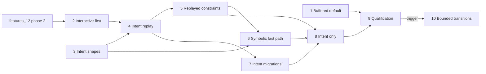

# features_13: intents that converge

Status: planned (2026-10-28). Starts while features_12 phase 2 finishes.
Carries over the still useful parts of features_12 phases 3–7, which
end there. Phase briefs record their own status; evidence goes beside
each brief as `NN-<name>-evidence.md`. Source code and tests define
current behavior.

## Destination

A transaction replicates as its **intent**: the SQL statements the
application ran and the values it bound. It no longer replicates as the
row images it happened to produce. Every replica holding a partition
replays that partition's transactions in one canonical order. A seal of
the tip fixes the set, so replicas at the same seal have the same rows
and the same list of dropped transactions, whatever the delivery order.
The application owns data meaning: counters, timestamps, merge rules.
Rocky only guarantees convergence.

That makes Rocky smaller. Per-field last-write registers, the mergeable
unique/foreign-key resolver with its hidden support rows, and most held
re-authoring disappear. Their cases become ordinary SQLite constraints
checked during replay and deterministic drops at the seal.

It also makes Rocky more expressive. Registers merge fields one at a
time and can build a row no transaction wrote, so today every `CHECK` is
refused. Replay executes whole transactions, so replayed tables accept
complex `CHECK` expressions, plus declared assertions for invariants
across rows and tables.

Interactive writes keep features_12's latency targets. Sync keeps
features_11's results.

## Why this shape

- **Row images lose intent.** `x = x + 1` and `x = 7` capture the same
  before/after rows (prototype qualification, gate 2). Registers then pick
  one winner per field, so concurrent increments lose updates. To get
  around that, applications build counters out of extra rows.
- **The constraint resolver is the largest unbounded holder.** Making a
  parent visible reveals all of its hidden children in one commit
  (features_12 phase 2, induced fan-out). Under replay, a child is either
  ordered after its parent or dropped. Nothing is hidden and revealed in
  bulk later.
- **The prototype measured the boundary.** Ordered replay with
  drop-at-seal is the part that guarantees convergence for arbitrary SQL
  (`query-merge-prototype/docs/convergence-contract.md`). Symbolic
  composition is exact only for a small algebra (add, assign, append,
  keyed delete, fresh insert) and only pays off where effects actually
  commute or collapse (`docs/hybrid-experiment.md`). So replay is the
  engine, and the symbolic engine is an optional fast path that must
  prove itself.
- **Partitions stay the unit of encryption and replay.** A replica can
  only re-run a predicate over rows it can decrypt. Intents therefore
  touch one partition each. The author splits a multi-partition
  statement into a bundle; bundles already exist and already hide
  partitions a reader holds no key for.

## Goals

| Measure | Baseline | Target | Phase |
| --- | --- | --- | --- |
| Replicas at one seal: rows and drop list identical | registers converge rows only | identical under every tested delivery schedule | 4, 5, 9 |
| Concurrent `x = x + 1` from two authors | one increment lost | both applied | 4 |
| Complex `CHECK` and cross-row assertions on replicated tables | every `CHECK` refused | accepted and enforced; violations drop deterministically | 5 |
| Interactive write under L1–L4, outside transitions (p95 / p99 / max) | features_12 phase 1 | desktop ≤ 16 / 50 / 100 ms; phone ≤ 33 / 100 / 250 ms | 2, 9 |
| Interactive write, idle (p95) | features_12 phase 1 | desktop ≤ 3 ms, phone ≤ 10 ms | 1, 4, 9 |
| Observer notification after `commit()` returns (p95) | features_12 phase 1 | ≤ 5 ms | 1, 4 |
| Single-row intent receive, in order, SQL statements | 83 (register path) | ≤ 45 | 4 |
| Single-row intent author, SQL statements | 87 (features_12 phase 1) | ≤ 43 | 4 |
| Late commuting transaction (fast path) | not available | no rewind; statements ≤ in-order receive + 5 ([met, but the crate was not merged](06-symbolic-fast-path-evidence.md)) | 6 |
| Induced typed-row work per acquisition in replayed tables | unbounded (constraint fan-out) | none; the fan-out exception and its counter are deleted | 5, 8 |
| Issuer 100k migration fill | 239.6 s (paired, loaded host) | ≤ 70 s | 7 |
| Member apply of the 100k migration | 15.2 s member pull (paired) | ≤ 110% of paired pull | 7 |
| WAL during the 100k migration | grows with the transaction | never above 64 MiB | 7 |
| `rocky-secure` non-test source lines | phase-start count | at least 2,500 fewer | 8 |

Load scenarios L0–L4, the write probe and the device classes are those
of [features_12 phase 1](../features_12/01-see-the-wait.md).

### Sync must not regress

Carried over unchanged from features_12. Each row is a paired comparison
against the features_13 start commit, on the same host and load.
Physical-device rows are checked in phase 9.

| Measure | features_11 result | Allowed after features_13 |
| --- | --- | --- |
| 32-row receive, statements per row | 6.40625 | ≤ 6.5 |
| Desktop receive throughput, 100k fixture member pull | 15.2 s (paired) | ≤ 110% of paired baseline |
| Phone 100k bootstrap, LAN | 16.6 s | ≤ 18.3 s |
| One-row sync phone ↔ desktop, LAN, p95 | 128.6 ms | ≤ 150 ms |
| Empty phone sync | 0.83–1.05 s | ≤ 1.15 s |
| Member file after 100k sync | 65.1 MB (phone) | ≤ 80 MB |
| Issuer file after 100k migration | 125.3 MB | ≤ 300 MB |

## Non-goals

- **A general SQL confluence prover.** The fast path covers only what it
  proves exactly. Everything else replays.
- **Invariant confluence for free.** Scarce resources (the last item in
  stock, a single owner) still need coordinated writes. Replay drops a
  losing transaction deterministically; it does not reserve rights.
- **Retry schedules.** A transaction that fails in canonical order is
  dropped. It is not retried in a later pass. The prototype's
  deferred-retry scheduler reorders transactions and costs n² attempts.
- **Deferred authoring or optimistic overlays.** As in features_12: an
  interactive transaction commits locally and concretely before it
  returns.
- **Backward compatibility.** Each persisted and wire format has one
  current version. Example and test databases are recreated. Nothing
  migrates register rows into replayed ones.
- **Link format changes.** Intents travel inside row payloads; the link
  format stays at 18.

## Settled

These resolve the questions raised while planning. Phases don't reopen
them. A phase that finds one unworkable stops and reports the evidence
instead of choosing differently.

### Semantics

- **Intent.** A transaction's intent is its ordered statements with bound
  parameters, its author stamp `(clock, author, sequence)`, its base (the
  tip frontier it read) and its partition. Statements are parsed and
  checked when the transaction commits. Values the application computed
  in its own code are already bound parameters. Read-modify-write in
  application code therefore freezes values, and `SET x = x + ?` keeps
  intent. The SDK documents this; Rocky does not try to infer it.
- **Canonical order.** Within a tip, a partition's transactions replay in
  `SecureStamp` order `(clock, author, sequence)`, the order the register
  path already uses for fields. Causal readiness governs completeness,
  separately from order. The hybrid clock is still decided at authoring.
- **Drops.** A transaction whose replay fails (a constraint, an admission
  refusal, a statement that no longer compiles against the schema) is
  dropped entirely: every statement in every partition of its bundle.
  The drop is provisional until a seal covers the transaction, and final
  from then on. Drops are seal-relative decisions, not tombstones. A
  later, larger frontier may let an earlier-ordered arrival displace a
  provisional winner.
- **Outcomes reach the application.** `TransactionToken` outcomes gain
  `Dropped { reason, final }`. Observers receive drops with the token
  after the local commit that records them. Kotlin exposes the same
  outcome. A local write stays visible until replay drops it. This is
  the one new thing a successful commit can later turn into.
- **Determinism.** Replayed statements may use DML on the table's own
  partition, reads within that partition, and an allowlist of
  deterministic SQLite functions. Clock, random, environment and unknown
  functions, `rowid`/`AUTOINCREMENT` keys, schema statements and
  extension loading are refused at commit. They are never accepted and
  later dropped. Keys come from bound values or the existing per-author
  identity allocation (`nextId`).
- **Engine identity is part of the tip.** Replay results depend on the
  SQLite build. The bundled SQLite version and Rocky's function allowlist
  are committed in the tip's schema manifest. A build with a different
  engine identity follows the tip read-only until the owner opens a new
  tip with it, exactly like a schema change. Rocky bundles SQLite, so
  this changes only on a Rocky upgrade.
- **Partitions.** An intent touches one partition. A statement that
  reaches several held partitions is split by the author into one
  statement per partition, each with the partition filter appended,
  reusing `rocky-storage`'s `partition_sql` rewriter. The copies commit
  as one bundle. A statement whose filter pins one partition produces one
  copy; unpartitioned tables are one partition. The split covers the
  partitions held when the transaction was authored. Views and full
  tables both mean "the partitions I hold". Partitions held but still
  incomplete refuse the write, as reads already do. Subqueries over other
  partitions are evaluated once by the author and bound as values.
  Writes to a partition column become moves (`replica/moves.rs`). More
  than `MAX_BUNDLE_FRAMES` (64) partitions refuses the statement; the
  bundle is never split into several transactions.
- **Admission runs on replayed effects.** Each replica checks paired
  row/field grants on the before and after rows its own replay produces.
  Replicas holding the partition replay identically, so they decide
  identically. A refusal is a drop with reason `Admission`.
- **Constraints.** Replayed tables accept unique indexes, foreign keys
  and any `CHECK` that uses only the deterministic function allowlist,
  enforced by SQLite during replay with SQLite's own semantics. Assertions
  (a name and a `SELECT` returning violating rows) cover invariants across
  rows and tables of one partition group. They run at the end of each
  author commit and each replayed transaction that wrote a table they
  read. Application triggers are not supported; assertions replace them.
  Details in [phase 5](05-replayed-constraints.md).
- **Coordinated tables.** A replayed table is declared coordinated or
  not. A coordinated table accepts only coordinated writes. They replay
  in coordinated-log order and are never dropped, because every
  replica's replay of that log prefix equals the author's. Foreign keys
  may point from an uncoordinated table to a coordinated one, never the
  other way. Scarce invariants live in coordinated tables.
- **Seals.** Seal authority does not change: owner devices seal. Besides
  today's event seals (schema change, revocation, recovery), an owner
  device seals routinely when the open tip holds
  `ROUTINE_SEAL_TRANSACTIONS` (1,024) unsealed replayed transactions, and
  at compaction. The constant is named and set from phase 4's rewind
  cost measurement. While no owner is online, the open tip grows; drops
  stay provisional, and rewinds stay correct but cost more. Qualification
  reports this.
- **Late transactions continue.** A transaction based on a sealed tip
  that its seal does not cover is not voided or held for re-authoring. It
  replays in the successor tip, ordered after the seal's members, against
  the successor's schema. If it no longer compiles there, it is dropped
  with reason `Schema`. This replaces held-change re-authoring for
  replayed tables.
- **Timestamps.** Per-field stamps and their author map leave the row
  record of replayed tables. Order comes from one stamp per transaction.
  The row's creation stamp stays: it is part of the signed creation
  proof used by moves, not an application "created at". Applications
  that want `created_at`/`updated_at` declare ordinary columns and bind
  the time as a parameter, since replay refuses clock functions.

### Engine

- **Replay mechanics.** An in-order arrival executes directly. An arrival
  ordered before already-applied transactions rewinds the partition to
  its insertion point using per-transaction before-image undo records,
  applies it, then redoes the suffix. Undo records exist only for the
  open tip and are deleted when a seal covers their transactions. Each
  redone transaction runs inside its own savepoint, so a failure drops
  only that transaction.
- **Rewinds are transition-class steps.** A rewind and redo must look
  atomic to readers. It starts only when no interactive waiter is
  registered (phase 2's gate) and is measured and reported like
  features_12 transitions. Routine seals bound its length. Bounding it
  further is phase 10's question.
- **Symbolic fast path.** A pure crate, `rocky-symbolic`, depending only
  on `rocky-core`, holds the intent algebra, the commutativity proof and
  symbolic composition. It has no SQLite, no I/O and no async code. If
  every crossed pair is proven to commute, `rocky-secure` applies the
  late arrival without rewinding; otherwise it rewinds and replays. There
  is one engine and no replacement trait. The crate lands only if it
  passes exhaustive equivalence against replay and shows a paired
  advantage (phase 6). Otherwise it is not merged.
- **Protocol types.** Intent wire types live in `rocky-core`. Replay,
  undo, the partition split and outcomes live in `rocky-secure` and
  `rocky-storage`, where the database transaction, admission and key
  scopes already are.
- **Transition period.** `TableClass::Replayed` is added beside
  `Mergeable` in phase 4. Phase 8 deletes `Mergeable` and the register
  path. Until then a schema may mix both; a foreign key between the two
  classes is refused.

### Carried over from features_12

- **Buffered Rust default** (features_12 phase 4, slice 1).
  `Database::transaction` commits with `Durability::Buffered`.
- **Interactive first** (features_12 phase 3). Two-class gate, yields at
  step boundaries, a starvation guard of 8 yields, and transitions that
  start only when the gate is quiet.
- **Work bounds, not wall-clock bounds**, so seeded simulation stays
  deterministic. Bounds are named constants next to the code they bound.
- **Cheaper commits become budgets.** features_12 phase 4's statement
  cuts targeted the register author and receive paths, which phase 8
  deletes. Its gates apply to the intent paths instead (phase 4). Its
  rules still hold: per-group work runs once per group, caches follow the
  phase 9 invalidation rule, and admission is never skipped.
- **Staged, resumable migration publication** (features_12 phase 5):
  staging, cursor, release gate, crash resume and per-chunk authority,
  applied to migration intents in phase 7.
- **Bounded transitions** (features_12 phase 7), deferred behind a
  trigger in phase 10, now including rewinds and seal finalization.
- **The features_12 phase 2 fan-out exception.** Phase 2 finishes with a
  named exception: the constraint resolver's dependent fan-out may exceed
  the input-row bound. It stays atomic, its induced typed-row changes are
  counted in test support and asserted to equal the dependent count, and
  its 1k and 10k child costs are measured and reported separately. Under
  phase 2 of this roadmap it starts only when the gate is quiet. Phase 8
  deletes it together with the resolver.

### Formats

Each phase that changes a persisted or wire format bumps that format
once and refuses every earlier version; nothing reads an older one.
Phase 4 bumps the row format (12 → 13) and the replica format for intent
frames, undo records and outcomes. Phase 5 changes the replayed row
record. Phase 7 adds the staging input. Phase 8 removes register records.
Phases that land in one release share one bump. Each phase states its
bump in its evidence.

## Phases

| Phase | Brief | Depends on | Effort | Required result |
| --- | --- | --- | --- | --- |
| 1 | [Buffered default](01-buffered-default.md) (implemented; qualification blocked) | none | 1–2 d | Rust SDK commits buffered |
| 2 | [Interactive first](02-interactive-first.md) | features_12 phase 2 | 1 w | Interactive writes wait for at most one bounded step; [implemented, latency gate unmet: reactor queueing](02-interactive-first-evidence.md) |
| 3 | [Intent shapes](03-intent-shapes.md) (measured; validation gate blocked) | none | 3–5 d | Measured transaction shapes; fast-path set and seal cadence chosen |
| 4 | [Intent replay](04-intent-replay.md) | 2, 3 | 3–4 w | `Replayed` tables: intents, split, replay, drops, outcomes; [slices 1–9 implemented; L0 gate unmet (baseline too), L2 regression open](04-intent-replay-evidence.md) |
| 5 | [Replayed constraints](05-replayed-constraints.md) | 4 | 2–3 w | Unique, FK, complex `CHECK` and assertions in replay; no field stamps or induced fan-out |
| 6 | [Symbolic fast path](06-symbolic-fast-path.md) | 3, 5 | 2 w | `rocky-symbolic`, merged only if proven and faster; [proven equal, not faster in the mix: not merged](06-symbolic-fast-path-evidence.md) |
| 7 | [Intent migrations](07-intent-migrations.md) | 4 | 2 w | Migrations publish as intents; bounded, resumable |
| 8 | [Intent only](08-intent-only.md) | 5, 6, 7 | 3 w | `Mergeable`, registers and resolver deleted; replayed checkpoints |
| 9 | [Qualification](09-qualification.md) | 1, 2, 8 | 1 w | Devices, convergence fuzz, sync non-regression |
| 10 (deferred) | [Bounded transitions](10-bounded-transitions.md) (planned; design after 8, code on trigger) | 8; 9 and its trigger | 1–1.5 w design, then ~1 w per kind | Transitions, rewinds and seal finalization in bounded steps |

Order: phases 1 and 3 start now; neither touches the code features_12
phase 2 is changing. Phase 2 follows features_12 phase 2. Phase 4 needs
both, because rewinds use the interactive gate and replay receive builds
on the bounded receive groups. Then two lanes:

- phase 5, then 6, in replay, constraints and the new crate
- phase 7, in SQL publication and SDK schema publication

When two lanes touch the same file, the later one rebases; neither
reverts the other. Phase 8 joins them. If phase 6 is not merged, phase 8
proceeds without it.

## Agent execution contract

Give an agent this README and one phase brief. Read the
[AGENTS instructions](../../AGENTS.md) first. Infer architecture and
ownership from source code, Cargo manifests, module declarations and
tests. Verify every prerequisite the brief names against code before
editing. If something this README calls settled doesn't match the code,
stop and report the mismatch rather than redesigning.

- Work through the brief's ordered slices. Record each slice's result in
  the phase's evidence file as you go, not at the end.
- Never weaken admission, durability, atomicity or the "publish only
  after the local commit and flush" rule. Never report success for
  missing behavior.
- Convergence claims need executable evidence: exhaustive delivery
  schedules (every permutation and packet partition) on small fixtures,
  compared against an independent reference that replays the canonical
  order from scratch. Seeded random schedules cover larger fixtures. The
  prototype in `~/AgentWorkspaces/query-merge-prototype` is a reference
  for algorithms and fixtures, not code to copy wholesale.
- Assert deterministic properties (statement counts, work bounds, drop
  maps, rewind lengths, crash resumption) in tests within their tier
  budgets. Timing targets are measurements recorded in evidence.
  Measurement tests are `#[ignore]`d and run explicitly in release mode.
- Record each measurement with: commit or change id, host, load, build
  profile, command, sample count and p50/p95/p99/max. Pair performance
  claims with the phase-start commit on the same host. If a target is
  shown unreachable within scope, report it with its profile; never
  quietly relax it.
- Use `jj`. Before finishing, run `./scripts/lint` and `./scripts/check`.
  For SDK or binding changes, also run
  `sdks/kotlin/gradlew -p sdks/kotlin check` and
  `./examples/shoppinglist-app/check`. Report what passed and what was
  not verified. Without devices, report device checks as not verified.
- Update the phase brief's status line and this README's phase table
  status when the phase lands.
